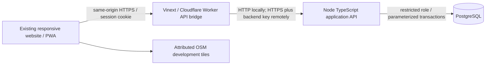

# Parkly architecture

Updated 28 October 2026. Repository `parkly/site`, branch `feature/mobile-app`. This is a working local full-stack implementation, not a production launch. The existing website and mobile project are preserved. The baseline is the user's requirements plus `public/project/requirements.csv`; a separate SRS is still unavailable. The later attached `мокап.jpg` was inspected as the floor-map UI reference.

## System and persistence boundary

The existing Next-compatible App Router, React 19, Vinext 1.0.0-beta.5/Vite, TypeScript, Tailwind and custom teal/neutral styles remain. Website views are hash routes within `/`: home, map, driver, operator, admin, finance. Details and reservation review remain dialogs. No broad route/style rewrite was needed.

`PARKLY_BACKEND_URL` selects PostgreSQL mode. `/api/demo` is a compatibility facade to PostgreSQL; `/api/availability` uses real space records; `/api/v1/*` exposes resource APIs. The Worker bridge forwards only selected headers, bounds bodies, times out, prevents redirects, marks responses no-store and requires a secret key for remote API origins. It never accepts database credentials in the browser. Once configured, backend failure returns 503; there is no automatic D1 or localStorage fallback.

The historical D1 implementation and migrations remain available for existing users when PostgreSQL is not configured. They are a separate mode/database, not synchronized storage. No existing D1 rows were altered or imported. A future import needs backup, schema preflight, mapping of shared demo identities to real accounts/organizations, reconciliation and approval. The pre-existing `.wrangler/state` could not be directly read in the earlier audit; it was not reset.

## Code ownership

| Layer | Code | Responsibility |
|---|---|---|
| Existing UI | `app/parkly.tsx`, `app/parking-map.tsx`, `app/globals.css` | Existing pages, geographic map/list, navigation and responsive identity |
| New UI components | `components/password-account.tsx`, `backend-account.tsx`, `hold-status.tsx`, `operator-tools.tsx`, `admin-access.tsx`, `server-reports.tsx` | Real account flow, resumable holds, sessions, notifications, scoped operations and database reports |
| Browser transport | `lib/api-client.ts`, `lib/contracts.ts` | Typed view records and structured API errors |
| Same-origin bridge | `lib/server/postgres-proxy.ts`, `app/api/v1/[...path]/route.ts`, existing API routes | Runtime backend selection, private headers/cookies and fail-closed behavior |
| HTTP boundary | `backend/src/server.ts`, `router.ts`, `validation.ts`, `errors.ts` | Exact origin checks, JSON/body limits, strict Zod DTOs, safe status/error codes and request IDs |
| Authentication | `backend/src/auth.ts`, `password.ts`, migration 003/006 | Salted scrypt, opaque hashed tokens, durable rate limits, login/logout audit |
| Transactions and queries | `backend/src/db.ts`, `queries.ts`, `compat.ts` | Transaction-local identity, parameterized SQL, RLS-backed projections and old-client actions |
| Database | `backend/migrations/001`–`008` | Entities, constraints, indexes, RLS, checked mutations and status/audit triggers |
| Local runtime | `backend/scripts/cluster.ts`, `local.ts`, `seed.ts`, `scripts/fullstack.mjs` | Private persistent local PostgreSQL, migrations, fictional fixtures and two-service startup |
| PWA and finance | Existing `public/sw.js`, manifest, offline assets, `lib/finance.ts` | Public-only fallback cache; classroom simulation remains separate from transaction records |

The large existing view is retained; incremental extraction can continue without replacing its working behavior. Root and backend dependencies have separate lockfiles/workspaces. Backend tests use real PostgreSQL 18.4 native binaries from a pinned development package. External PostgreSQL can be configured through environment variables; the native launcher is local development only.

## Data model

Authentication is isolated in `auth.accounts`, `auth.sessions`, `auth.rate_limits`. The application schema contains profiles, many-to-many user roles, operators/memberships, facilities/floors/spaces, versioned hourly pricing rules, shared space allocations, holds, reservations/extensions, maintenance blocks, parking sessions, booking status history, notification preferences/subscriptions/deliveries, audit logs, action request deduplication, favorites and tenant-scoped floor-layout drafts.

All operational timestamps are `timestamptz`, with UTC transactions/storage and `Asia/Almaty` display. APIs accept epoch milliseconds for requested windows and return epoch milliseconds or ISO UTC timestamps as documented. Money is integer KZT; pricing is hourly, 1–24 whole hours, within 90 days. No dynamic pricing, tax invoice or payment ledger is implied.

`space_allocations` is the single capacity constraint boundary. A generated half-open `tstzrange` and GiST exclusion constraint prevent unreleased overlapping claims for the same space across holds, reservations and maintenance. Adjacent ranges do not overlap. Database checks/FKs prevent negative values and invalid references; per-space row locks serialize mutations. Inventory reduction deactivates concrete spaces only after checking their outstanding claims and sessions. Price edits add a version; original booking price remains fixed.

A five-minute hold captures the agreed quote and claims inventory before confirmation. Confirmation converts the same allocation into a reservation in one transaction. Scoped request UUIDs and advisory locks deduplicate retries. Cancellation and extension each have durable request records; reuse with different details conflicts. Extensions add a line item and update the claim/total atomically; an exclusion conflict rolls everything back. Booking/hold transitions append history through triggers. Terminal reservations cannot be resurrected.

An API sweep every 15 seconds (bounded batches with SKIP LOCKED) and on-demand capacity operations release expired holds and ended reservations without active sessions. Expired confirmation commits release before returning 410. The browser countdown is advisory. Active operator-recorded sessions prevent automatic completion/expiry; overstays require operator action. Inventory represents time reservations, not independently verified vehicle occupancy.

## Authentication and authorization

The course prototype disables public signup by default. Local setup pre-provisions invented driver/operator accounts with random passwords in ignored `backend/.local/.env`; database URLs and VAPID/encryption secrets are also stored there with mode 0600. The old JSON secret files are migrated without a database reset. Isolated tests may explicitly enable historical signup, which creates a driver only; clients cannot select roles. Passwords are salted scrypt hashes; session tokens are random 256-bit values with only SHA-256 digests in PostgreSQL. Cookies are HttpOnly, SameSite=Strict, 24-hour expiry and Secure on HTTPS. Login rotates the browser session; logout revokes it; disabling a user revokes their sessions. Every request rechecks account status. Authentication and mutation limits are durable database counters; raw credentials and emails are not written to operational audit logs.

The API login is NOSUPERUSER, NOBYPASSRLS, NOCREATEROLE, NOCREATEDB and owns no app/auth tables, including through owner-role membership. Startup rejects an unsafe role. Every API transaction sets authenticated identity with transaction-local `set_config`, preventing pooled identity leakage. Browser identities never become SQL role names or query text.

All app tables have RLS. Drivers see their own bookings/sessions/profile; operator members see organization bookings/facilities; administrators have reviewed cross-organization access. The runtime role has no direct booking, inventory, membership, role or audit writes. Trusted SECURITY DEFINER functions owned by the migration role implement explicit identity/tenant checks with a fixed search path; owner bypass is intentional inside these functions, so FORCE RLS is not claimed. A few own-user preferences/profile/favorite writes use narrow grants and RLS directly. Auth tables have no runtime direct read/write grants; only checked functions are executable.

Admin APIs manage account enablement, roles, memberships, organization creation and listing approval. Self-disable/self-admin removal and last-active-admin loss are protected. New facilities start pending and fictional. There is no public bootstrap-admin endpoint. Production bootstrap must be a reviewed, out-of-band database operation.

Database credentials are trusted service credentials, never end-user credentials. RLS defends against omitted application WHERE clauses; it does not make a compromised API credential safe, because that service is trusted to set transaction identity. Protect both the service and its database network path.

## PWA, privacy and production boundaries

The service worker caches only explicit public fallback/icons. API/auth/account responses and mutations are never cached; offline booking is unavailable. PWA installability assets and static MIME/cache headers are preserved. Real iPhone installation/push delivery is not verified here. The reminder extension now implements encrypted subscriptions, explicit permission opt-in and a durable Web Push sender; physical-device acceptance testing remains pending.

No real partners, payment processing, revenue collection, sensors, barrier integration or independently verified occupancy exist. Existing fictional markers and approximate coordinates are retained. Source fields distinguish demo/operator-updated inventory from unavailable physical occupancy. A session entry is operator-recorded, not proof of presence from a sensor.

Production requires approved hosting and Kazakhstan privacy/data-location review, managed PostgreSQL/backups, external restore tests, privileged MFA, email verification/recovery, TLS ingress/key provisioning, monitoring, release CI, load/security/device testing and approved provider contracts. No production systems were changed.

Primary design references consulted: [PostgreSQL RLS](https://www.postgresql.org/docs/current/ddl-rowsecurity.html), [range constraints](https://www.postgresql.org/docs/current/rangetypes.html), [Node crypto](https://nodejs.org/api/crypto.html), [embedded-postgres source](https://github.com/leinelissen/embedded-postgres). Implementation evidence is recorded in `VERIFICATION.md`.

## Interactive floor-map extension

`components/floor-booking.tsx` opens from existing parking cards. It loads `/facilities/:id/layout` for exact arrival/departure and uses the backend quote. `floor-canvas.tsx` renders structured SVG bays/features with pointer pan, two-pointer pinch, wheel/button zoom and keyboard selection; a list alternative remains available. Green is available for the interval, gray unavailable, blue selected and amber held. No physically occupied state is asserted. Floors and identifiers come from PostgreSQL, not an image.

Spaces have scalable integer x/y/width/height/rotation coordinates. Floors have dimensions, driveway/entrance/exit features and publication versions. Operators edit only assigned floor documents. Save uses optimistic draft versions; preview does not alter public data; publication atomically copies checked geometry/labels/reservability to the published records. New editor spaces start unpublished/non-reservable. Public layout responses hide them even from a manager using the driver view. Unknown/foreign/duplicate IDs and labels are rejected; rotated bounds are validated.

The floor hold countdown uses the server deadline, server time and monotonic elapsed time with a network-time estimate. The original transaction engine revalidates under a space lock; an exclusion constraint remains the final conflict guard. Matching own holds can be restored when reopening the same interval. Bookings persist across refresh and logout. The native app remains separate and is not rewritten by this website feature.

## Durable reminder extension

Migrations 009–012 add encrypted per-user/device subscriptions, four versioned UTC reminder jobs, unique job/device deliveries, leased worker claims and per-attempt history. The restricted `parkly_notifications` role has queue-function access only. Local startup runs the worker with persistent keys; production runs it independently from the API under a supervisor. Only the worker needs the VAPID private key.

Confirmation, cancellation, completion and extension update scheduling through database triggers inside the booking transaction. The service worker validates a short-lived generic-message capability, deduplicates delivery IDs and opens a normal authenticated own-booking route. No endpoint/location/email is in the encrypted push payload. Browser timers update the display only. See NOTIFICATIONS_DEPLOYMENT.md for exact retry semantics, privacy boundaries, current APIs and verification limits.

## Workspace completion modules

`backend/src/workspaces.ts` handles paginated histories/reports, support,
applications, admin operations and listing metadata; `summary.ts` provides
user-scoped uncapped aggregates. Migrations013/014 add RLS-protected operational
records, checked write functions and password/session revocation. New UI workflows
use `hooks/use-resource.ts` with cancellation and request-keyed state to prevent
stale responses from replacing a newer resource. Existing root refreshes use a
sequence guard. The legacy root views and independent native app are retained.
See `WORKFLOW_COMPLETION.md` for current verification and release limitations.
