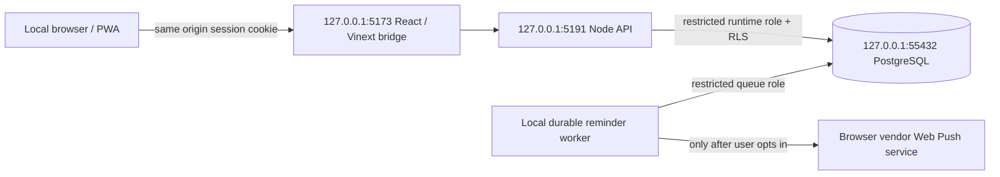
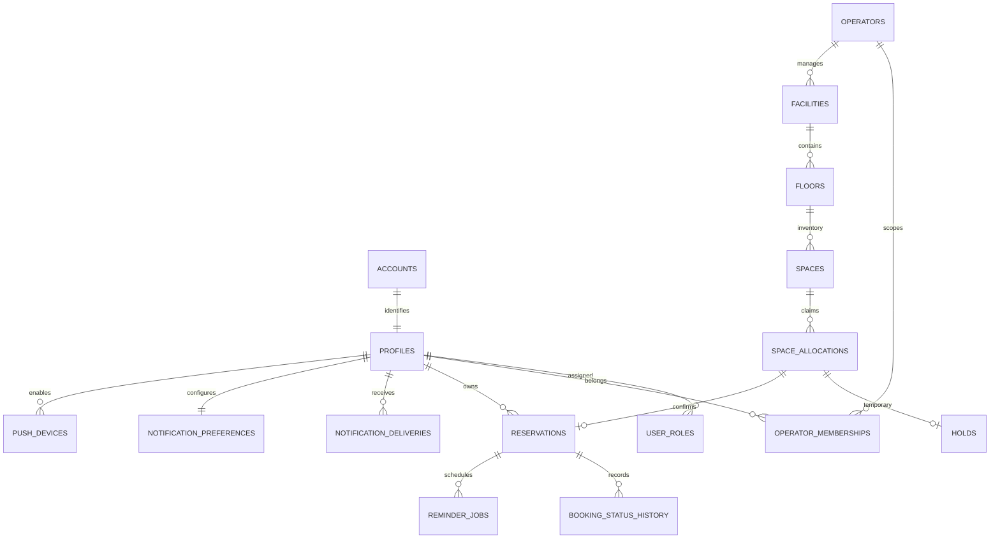
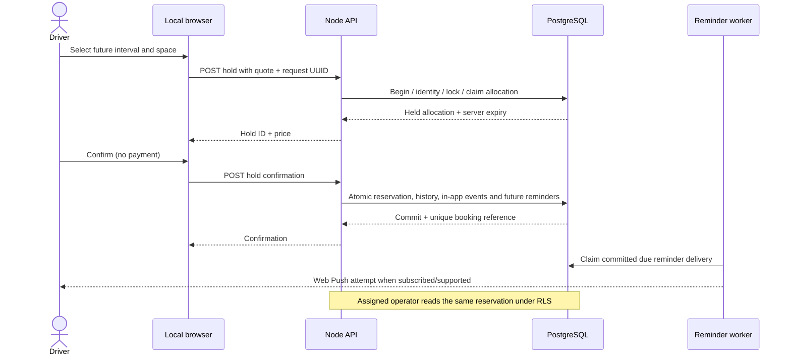
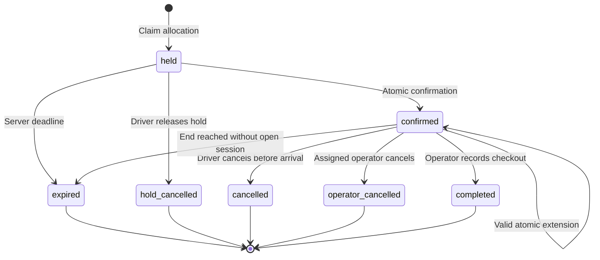

# Course prototype scope and evidence

Verified 13 November 2026, Asia/Almaty. This document supersedes older publication guidance for the current course task. All test identities, bookings, facilities, support messages and financial figures are fictional.

## Requirement decisions

| Source conflict | Current decision |
|---|---|
| Master prompt requires cloud deployment and independence from the laptop; professor permits localhost and forbids public exposure | Run on 127.0.0.1 only. No deployment, public registration, tunnel, advertisement, card or paid plan. Historical hosting adapters remain unused. |
| Master prompt asks for Supabase Auth/PostgreSQL and a Next Route Handler-only backend; existing software already has a working PostgreSQL API | Preserve the native PostgreSQL database, migrations, RLS, scrypt/session authentication and Node API behind the same-origin App Router bridge. No Supabase migration is claimed. |
| Previous README allowed signup and stored credentials in private JSON | Disable public signup server-side and in the form; provision driver@test.local/operator@test.local. Move local runtime, fixture and push secrets into ignored backend/.local/.env (0600), preserving existing data/keys. |
| Real payments versus booking prices | Prices are fictional KZT quotes. Confirmation changes reservation state, charges nothing and never asks for card data. Reports label simulated values. |
| University notice versus product branding | README files begin with the exact required university statement. Product screens show a generic educational/fictional-data notice without university branding. |

A standalone SRS was not available in this checkout. The preserved `public/project/requirements.csv`, `docs/REQUIREMENTS_TRACEABILITY.md` and the supplied master prompt are the baseline. IDs FR-01–FR-30 (including FR-04a/04b) are preserved. FR-16 is partial for complete Russian localization; FR-21 is partial for real-device push acceptance; FR-30 still needs full device/accessibility usability acceptance. Local code covers the main search/reservation/cancellation/role/notification workflows; those limitations must not be presented as passed device tests.

The full requirement-to-objective/use-case/screen/API/test/status mapping is [COURSE_RTM.md](COURSE_RTM.md).

## Executed checks

| Command/check | Actual result |
|---|---|
| `pnpm typecheck` | PASS |
| `pnpm backend:typecheck` | PASS |
| `pnpm lint` | PASS, zero warnings |
| `pnpm test` | PASS, 17 tests |
| `pnpm backend:test` | PASS, 45 passed, 0 failed, 1 skipped |
| `PARKLY_BACKEND_URL=http://127.0.0.1:5191 pnpm build` | PASS, all five Vinext build stages |
| `PARKLY_TEST_URL=http://127.0.0.1:5173 node tests/fullstack.integration.mjs` | PASS, 21 website/API bridge steps; signup separately rejected with 403 |
| `PARKLY_TEST_URL=http://127.0.0.1:5173 pnpm test:pwa` | PASS, manifest, service worker, offline fallback, 192px icon and academic download |
| `node scripts/check-course-safety.mjs` | PASS; README notices/ignore rules and 139 historical blobs checked for current generated credentials and private-key blocks; not a universal detector |
| `lsof -nP -iTCP:5173 -iTCP:5191 -iTCP:55432 -sTCP:LISTEN` | Website/API/PostgreSQL bind exclusively to 127.0.0.1 |

Initial backend tests were blocked by sandbox `listen EPERM`; re-running with permission for local listeners passed. That initial failure is not hidden or classified as an application test pass. The skipped test attempts encrypted Web Push against an external invalid synthetic endpoint; no real-device delivery is asserted. The durable sender currently handles driver end-time reminders, not immediate confirmation/cancellation pushes to both roles. Immediate booking-change messages are in-app records. Extending the sender to those driver/operator events is remaining master-prompt work. No hosting, remote database, physical parking or payment system was used.

## Acceptance cases

All cases use fictional data. Tests create isolated temporary PostgreSQL clusters unless explicitly identified as the retained local website bridge. No real students were enrolled or tested.

| Test ID / FR | Preconditions and test data | Steps | Expected | Actual / status |
|---|---|---|---|---|
| AT-01 / FR-12 | Default HTTP handler, invented blocked@test.local | POST signup without test-only registration option | 403 REGISTRATION_DISABLED | PASS, backend postgres test |
| AT-02 / FR-12 | Seeded driver@test.local and operator@test.local; random .env passwords | Login each, GET own identity | Correct driver/operator roles | PASS, backend postgres test; both browser logins checked |
| AT-03 / FR-01,02 | Approved fictional lot fixtures | Search case-insensitive area/name; combine type and price boundary | Matching approved lots only | PASS, root parking tests |
| AT-04 / FR-03,17 | Local website + fictional driver, future 2h interval | Load floor, select available bay, request hold | Real floor/space IDs, server quote and five-minute deadline | PASS, 21-step bridge and browser Floor 2/A-12 hold |
| AT-05 / FR-04a | Valid own hold | Confirm; repeat same confirmation | One persistent reference; same booking on replay | PASS, backend/bridge; browser confirmed an 800 KZT fictional booking |
| AT-06 / FR-05 | Two invented drivers, same future space/time | Submit two holds concurrently | Exactly one success and one 409; no overlap | PASS, real PostgreSQL race and direct exclusion-constraint tests |
| AT-07 / FR-04b | Own confirmed future booking | Cancel twice with same key; reload history | One cancellation, retained history, capacity released | PASS, backend/bridge; confirmed→cancelled history |
| AT-08 / FR-06 | Fictional North and East operators, North facility | East operator and driver attempt North inventory edit | 403, no unauthorized change | PASS, backend postgres test |
| AT-09 / FR-04a,12 | Two invented users, other's booking | Read/cancel other user's reservation; direct RLS SELECT/UPDATE | Hidden record/404, direct write denied | PASS, API and SQL authorization tests |
| AT-10 / FR-10,22 | Own booking + adjacent conflicting reservation | Try conflicting extension, then available quoted extension and replay | Rejected conflict leaves original; successful extension applied once | PASS, backend/bridge; original 400 KZT fixture preserved on conflict |
| AT-11 / FR-11,19,20 | Encrypted synthetic subscription, isolated worker and queue | Dispatch concurrently; retry transient failure; revoke/expire subscription | Unique delivery claim, retry identity retained, invalid subscription disabled | PASS, reminder worker tests; physical-device display NOT VERIFIED |
| AT-12 / FR-27 | Own and foreign fictional notifications | Read own notification, attempt another user's read | Own read persists, foreign denied | PASS, workspace and bridge tests |
| AT-13 / FR-29 | Fictional account, wrong/current/new synthetic password | Reject wrong password; change valid password; reuse old sessions | Wrong secret rejected, sessions revoked, new login works | PASS, isolated workspace tests; regular demo passwords unchanged |
| AT-14 / NFR-PWA | Served localhost static assets | Fetch manifest/SW/icons; test cache bypass | Standalone manifest, icons, no private API caching | PASS, PWA unit and HTTP checks; installation on device NOT VERIFIED |

Test implementations are in `backend/tests/postgres.test.ts`, `reminders.test.ts`, `workspaces.test.ts`, `service-worker.test.ts`, `netlify.test.ts`, `tests/parking.test.ts`, `pwa.test.ts` and `fullstack.integration.mjs`. Historical adapter tests run locally, not on Netlify.

## Architecture and ER overview

Push uses a browser vendor's delivery endpoint when explicitly enabled; the application/database remain on loopback. No visitor analytics or real-user collection is configured.

This is a focused logical overview; migration SQL is authoritative and includes auxiliary support, layout, sessions, pricing, audit and delivery tables.

Hold states are `held/confirmed/cancelled/expired`; `hold_cancelled` is a diagram alias for the hold's `cancelled` value. Reservation states are `confirmed/cancelled/operator_cancelled/completed/expired`. Extension preserves reservation status and appends its own history/price record.

| Role | Permitted access |
|---|---|
| Driver | Own bookings, notifications, preferences, favorites and support; approved fictional facility search |
| Operator | Assigned organization inventory/layout/pricing/reservations/sessions and reports; own account data |
| Administrator fixture | Reviewed local organization/access/approval/audit controls; no public bootstrap |
| Anonymous | Educational notice and fictional discovery; no booking/account/privileged mutation |

Browser walkthrough also confirmed the same 800 KZT reservation in the operator workspace, then changed it to `operator_cancelled` through the confirmation dialog. At a 375×812 browser viewport the operator screen had documentWidth=viewportWidth=375, with no horizontal overflow. This is a viewport check, not physical-device QA. Captures are in ignored `outputs/course-qa/`.

## Three-minute recording script

- 0:00–0:20: Explain the educational notice, fictional data and localhost-only scope. Keep .env and passwords off screen.
- 0:20–0:50: Driver is already signed in. Search an area, filter price, open the fictional facility and choose floor/space/time.
- 0:50–1:20: Hold, review KZT quote, confirm without payment. Show unique reference and stored reservation.
- 1:20–1:50: In a separate pre-authenticated operator browser session, show the same booking and assigned-facility capacity.
- 1:50–2:20: Cancel before arrival as the driver. Refresh operator view and show cancellation/history and released allocation.
- 2:20–2:45: Open Notification Center and explain opt-in Web Push; distinguish actual in-app records from unverified physical-device display.
- 2:45–3:00: Show test results and requirement mapping. State remaining device/usability limits and video URL placeholder.

University OneDrive demo URL: **[TO BE ADDED AFTER RECORDING]**.

## Manual usability guide — three external student testers

No participants have been recruited and no results are claimed. Give each tester an invented account/display name and ask them to use only invented data locally. Do not record real names, emails, vehicle plates, payment data or passwords. Keep observations as Tester A/B/C.

Each tester independently finds a parking below 400 KZT/hour, selects a future two-hour interval and free bay, confirms a fictional reservation, locates the booking reference, cancels before arrival and finds the cancellation notification. One tester then uses the pre-provisioned operator account to locate the booking and explain inventory versus physical occupancy. Record task completion, elapsed time, errors, confusing labels and a 1–5 ease score, without prompting the answer. Do not invent scores or test outcomes. Report findings and repeat failed tasks after fixes.

A real desktop push check, if a compatible browser is available: opt in explicitly on fictional driver/operator sessions, create/cancel a fictional booking, verify the committed record and inspect actual OS/browser notification display while the app is backgrounded. Record browser/OS/version, permission/subscription state and observed result. Browser/OS delivery is conditional. iPhone Home Screen testing requires an approved accessible HTTPS setup; this localhost-only task does not provide it.

## Private repository preparation, 14 November 2026

Private source upload to GitHub is authorized separately from website publication. See GITHUB_SETUP.md and VERCEL_DEPLOYMENT.md. The added Vercel adapter reuses existing business logic and passed an isolated PostgreSQL workflow test. Current backend count is 46 passed, 1 external transport test skipped. The original 13 November evidence above remains a dated snapshot.
